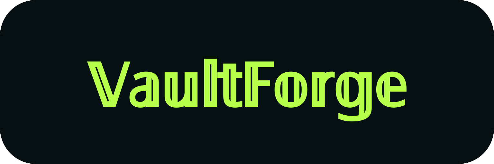

<p align="center">
  
</p>

> [!WARNING]
> VaultForge is provided on an “as is” basis. Although reasonable efforts have been made to address security risks, no guarantee is made that the software is free from vulnerabilities or will safeguard your assets. Use of VaultForge is at your own risk. To the fullest extent permitted by law, the author and contributors disclaim liability for any loss of funds or other damages arising from its use.

# VaultForge Wallet

A local-first crypto wallet desktop app built with a React frontend, Coinbase Design System, and a Rust backend through Tauri.

## App demo

https://github.com/user-attachments/assets/ff082c14-b698-4070-8c10-5ca884f6a4ed

## Features

- Create, import, lock, and unlock a wallet session
- Optional BIP-39 passphrase when creating or importing a wallet
- Portfolio dashboard with token balances, allocation, weighted 24h change, optional Unicode crypto symbols, and USD, EUR, GBP, or JPY valuation selectable during setup or in settings
- Activity transaction hashes and sender/recipient addresses link to their chain explorers
- Sign and review chain-specific transactions before broadcasting them
- Basic real transfer paths for BTC, EVM native/ERC-20, Solana native/classic SPL and Token-2022 assets, Tron native and configured TRC-20 assets, and XRP Ledger native XRP
- Review provider-derived fees, total debit, selected fiat value, and post-send balance estimates
- EVM, Solana, and Tron transactions recheck actual balances before signing
- Solana token sends validate live mint/account programs and extensions, prefer the sender’s ATA, and use checked transfers. Token-2022 transfer fees are calculated per source account from the active epoch schedule; the entered amount is the total token debit. Review shows recipient net amount, token fees, SOL fee and account rent separately. Custom transfer hooks, confidential transfers and other unreviewed extensions remain unavailable. Funded Token-2022 send validation is not yet available.
- XRP Ledger native sends use live account balance, reserve, fee, and sequence data; they support classic addresses, destination tags, and short on-ledger memos
- Encrypted local wallet storage using the app data directory with AES-GCM
- Activity details with transaction hashes, signatures, payload hashes, and copy actions
- Ordinary send status updates are saved in encrypted wallet storage and survive reloads
- Wallet-password confirmation and strength feedback for encrypted wallet setup
- One-time risk acknowledgment before wallet setup or unlock, with the full MIT License available in-app
- Send, receive, swap, assets, activity, and settings screens
- Same-chain and cross-chain (EVM) swap routes through Relay and LI.FI on supported EVM networks and Solana and direct single-pool Uniswap V3 support for same-chain ERC-20 pairs. Available providers are ranked by exact output.
- CCTP v2 support on EVM chains and Solana
- Responsive React and Coinbase Design System UI with desktop sidebar

Relay's authenticated quote service can take `VAULTFORGE_RELAY_API_KEY` from the Rust process environment for less rate limiting. Set it when launching the app (for development, `VAULTFORGE_RELAY_API_KEY=your-key bun run tauri dev`). The key is never included in frontend state or wallet storage. Similarly, LI.FI optionally uses `VAULTFORGE_LIFI_API_KEY` and Jupiter can use `VAULTFORGE_JUPITER_API_KEY`.

### Coming soon

- Tron swaps (the current LI.FI TVM route cannot yet pass the wallet's transaction validation and signing flow)
- Zcash (ZEC) support with support for shielded addresses planned

For a full list of upcoming features (there are quite a few!), click [here](https://github.com/kunningKing11/vaultforge/blob/main/ROADMAP.md).

## Supported chains

- Bitcoin Mainnet (BTC)
- EVM: Ethereum Mainnet (ETH), Arbitrum One, Avalanche C-Chain (AVAX), Base, BNB Smart Chain (BNB), Monad (MON), Optimism, and Polygon (POL)
- Solana Mainnet (SOL)
- Tron Mainnet (TRX, USDT, USD1, TRUMP, and the legacy USDC TRC-20 contract, with balance and transfer support)
- XRP Ledger Mainnet (XRP; native transfers only)

## Token registry

The bundled tokens are summarised below; exact contracts, mints and decimals are in [the registry](src/networks.json). Native coins are listed under Supported chains above.

| Chain / token group                     | Tokens                                                                    |
| :-------------------------------------- | :------------------------------------------------------------------------ |
| Ethereum, Avalanche C-Chain, Polygon    | AAVE, LINK, UNI (UNI.e on Avalanche), USDC, USDT; Polygon also has USDC.e |
| Ethereum — additional                   | H (Humanity), PEPE, SHIB                                                  |
| Arbitrum One, Base, Optimism            | AAVE, LINK, UNI, USDC                                                     |
| BNB Chain                               | AAVE, LINK, UNI                                                           |
| Monad                                   | LINK, USDC                                                                |
| Solana — Jupiter                        | JUP, JLP, JupSOL, JupUSD                                                  |
| Solana — Jupiter Lend receipts          | JUICED, jlUSDC, jlUSDT, jlWSOL, jlEURC, jlUSDS, jlUSDG, jleUSDG, jlePYUSD |
| Solana — stablecoins and wrapped assets | USDC, USDT, USDS, USDe, USD1, EURC, cbBTC, WSOL                           |
| Solana — staking                        | JitoSOL, mSOL, BNSOL                                                      |
| Solana — DeFi / DePIN                   | AAVE, LINK, UNI, RAY, ORCA, MET, JTO, PYTH, KMNO, DRIFT, W, HNT, RENDER   |
| Solana — Pump                           | PUMP                                                                      |
| Solana — memecoins                      | BONK, WIF, PEPE, PENGU, FARTCOIN, TRUMP, MELANIA, USELESS                 |
| Tron                                    | USDT, USD1, TRUMP and legacy USDC TRC-20 balances and transfers           |

Bridged, CCIP and ERC-677 variants remain separate assets by contract or mint, even when their tickers match.

<details>
<summary>Registry sources and verification</summary>

- EVM and bridged tokens: [Uniswap token list](https://tokens.uniswap.org), [UNI documentation](https://developers.uniswap.org/docs/ecosystem/governance/uni), [Chainlink documentation](https://docs.chain.link/resources/link-token-contracts), [Avalanche bridge registry](https://github.com/ava-labs/avalanche-bridge-resources/blob/main/avalanche_contract_address.json), and [Wormhole token registry](https://github.com/wormhole-foundation/wormhole-token-list/blob/main/content/by_dest.csv). Solana Wormhole mints use eight decimals; the separate Chainlink LINK mint uses nine.
- Humanity uses the [migrated Ethereum H contract](https://announcements.bybit.com/en/article/bybit-will-support-the-humanity-h-contract-migration-bltb4caa60378a0ed28/), with its name, symbol and decimals verified on-chain.
- Ethereum memecoins: [PEPE](https://www.pepe.vip) and [SHIB](https://shib.io/tokens/shib), with contracts and decimals verified on-chain. Pepe publishes raster artwork only, so its bundled SVG is a pinned [Web3 Icons](https://github.com/0xa3k5/web3icons) vector recreation.
- [Solana PEPE](https://jup.ag/tokens/PEPEqnuuCDbBC89p1u9vpnP1KQ2oj1xTcQBsjt9X55m) uses the Jupiter-verified classic SPL mint with four on-chain decimals and per-mint pricing; it retains a separate asset identity from Ethereum PEPE.
- Solana: [Jupiter's verified token metadata](https://developers.jup.ag/docs/tokens/token-information) and Lend asset catalogues for the [main](https://api.jup.ag/lend/v1/earn/tokens) and [Ethena](https://api.jup.ag/lend/v1/earn/tokens?market=ethena) markets, checked against finalized mainnet mint accounts. The Token-2022 receipts jlUSDG, jleUSDG and jlePYUSD retain separate mint identities and per-mint pricing; their icons use Jupiter’s official Lend SVG. [PUMP](https://pump.fun/pump-token) uses its official Token-2022 mint and bundled issuer SVG. CoinGecko IDs are matched by exact Solana mint using its [asset registry](https://api.coingecko.com/api/v3/coins/list?include_platform=true).

</details>

### Supported features

The table distinguishes implemented backend paths from network entries that are currently address or validation scaffolding. “No” means the feature is not implemented yet.

| Chain             | Native transfer            | Token transfer          | NFTs / Filecoin storage / Shielded pools (whichever are applicable) |
| :---------------- | :------------------------- | :---------------------- | ------------------------------------------------------------------: |
| Arbitrum One      | Yes                        | ERC-20                  |                                                                  No |
| Avalanche C-Chain | Yes                        | ERC-20                  |                                                                  No |
| Base              | Yes                        | ERC-20                  |                                                                  No |
| BNB Smart Chain   | Yes                        | ERC-20                  |                                                                  No |
| Bitcoin           | Yes (BIP84 P2WPKH account) | No                      |                                                                  No |
| Ethereum Mainnet  | Yes                        | ERC-20                  |                                                                  No |
| Filecoin          | No                         | No                      |                                                                  No |
| Injective         | No                         | No                      |                                                                  No |
| Monad             | Yes                        | ERC-20                  |                                                                  No |
| Optimism          | Yes                        | ERC-20                  |                                                                  No |
| Polygon           | Yes                        | ERC-20                  |                                                                  No |
| Solana            | Yes                        | SPL / Token-2022        |                                                                  No |
| Tron              | Yes                        | Yes (configured TRC-20) |      No (wallet transaction validator supports EVM and Solana only) |
| XRP Ledger        | Yes (classic addresses)    | No                      |                                                                  No |
| Zcash             | No                         | No                      |                                                                  No |

## Development

### Chain and coin icons

`src/icon-manifest.json` pins sources, checksums, and mappings for offline icons in `public/icons/`. SVGs are preferred (for obvious reasons, they don't lose quality at different sizes), however issuer PNGs or JPEGs are accepted when a reviewed SVG is unavailable.

Run `bun run icons:download` to download the icons, `bun run icons:check` to verify the icons offline (comparing them against their hash), and `bun run lint:icon-order:fix` to sort entries. Review upstream changes before updating checksums. Use `assetIconPath` and `chainIconPath` from `src/assetIcons.ts`; unknown or failed icons use a bundled fallback. Icons do not imply transaction support.

### Setup

Use the Bun version specified by `packageManager` in [package.json](package.json); CI and release builds use the same version. Bun performs type checking, and the installed TypeScript dependency supports editors.

**Install dependencies:**

```bash
bun install
```

Bun applies a three-day minimum release age when resolving new direct and transitive npm dependencies. Existing `bun.lock` entries and lockfile changes produced by Dependabot are not rechecked against this policy. For an urgent, reviewed update, temporarily add its exact `name@version` to `minimumReleaseAgeExcludes` in `bunfig.toml`, then remove the exception when it is no longer needed.

**Run the web frontend:**

```bash
bun run dev
```

**Run the Tauri desktop app:**

```bash
bunx tauri dev
```

**Build the frontend:**

```bash
bun run build
```

Build the desktop bundle:

```bash
bun run prepare-tauri
bunx tauri build
```

`prepare-tauri` caches icon hashes locally and regenerates the desktop and mobile icons when needed.

The manually dispatched Release workflow builds signed updater packages using `TAURI_SIGNING_PRIVATE_KEY` and an optional password. `scripts/prepare-release-assets.mts` collects the builds and signatures and generates `latest.json`, including each package's download size; missing or ambiguous packages or signatures block publication. The Settings updater requires a published release containing these files. Older releases without sizes show an unknown download size.

**Check and fix frontend (TypeScript) issues:**

```bash
bun run check
bun test --parallel
bun run lint:fix
bun fmt .
```

`dev` and `build` run the non-mutating Oxlint, Bun formatting, and Bun type checks before starting the Bun development server or production build. Run `./lint.sh` for the same checks or `./lint.sh --fix` to apply safe lint fixes and formatting first.

Formatter settings and the dependency release-age policy live in `bunfig.toml`.

`bun run lint` and the pre-commit hook also check that dependency names are alphabetized within each Cargo dependency table. Run `bun run lint:cargo-order` to check this separately.

Commit hooks check message length, sync versions and dependencies, and run lint, formatting, type checks, TypeScript tests, `cargo fmt --check`, and `cargo check`. Push hooks run dependency audits, TypeScript and Rust tests, and verify the Cargo lockfile. Failed checks block the commit or push. Formatting checks staged files and type checking uses a staged snapshot; other checks use the working tree.

You can run the same checks manually with `bun run hooks:check -- commit` or `bun run hooks:check -- push`. After cloning or installing dependencies, `bun install` installs the Git hooks through the `prepare` script; run `bun run prepare` in an already-installed checkout.

`src/networks.json` is the source of truth for network identities, provider URLs, native assets, configured ERC-20 assets, decimals, and CoinGecko identifiers.

### Project Structure

- `src/react/`: React screens, application state, and styles.
- `src/`: frontend entry point, wallet API, network registry, and shared types and utilities.
- `scripts/`: build, registry, icon, and release tooling.
- `tests/`: frontend unit tests.
- `src-tauri/src/commands/`: Tauri command boundaries for wallet, transaction, market, and swap actions.
- `src-tauri/src/providers/` and `src-tauri/src/tx/`: chain providers and transaction construction, encoding, and signing.
- `src-tauri/src/`: wallet state, encrypted storage, derivation, operations, swap and CCTP orchestration, and Tauri setup.
- `src-tauri/src/tests/`: Rust unit tests.

## License

VaultForge is licensed under the [MIT License](LICENSE). It is provided "as is," without warranty; see the license for the full terms.
